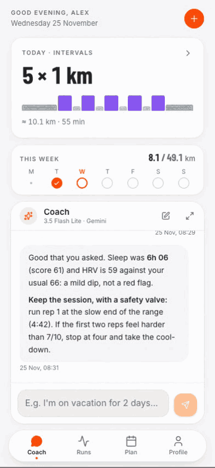
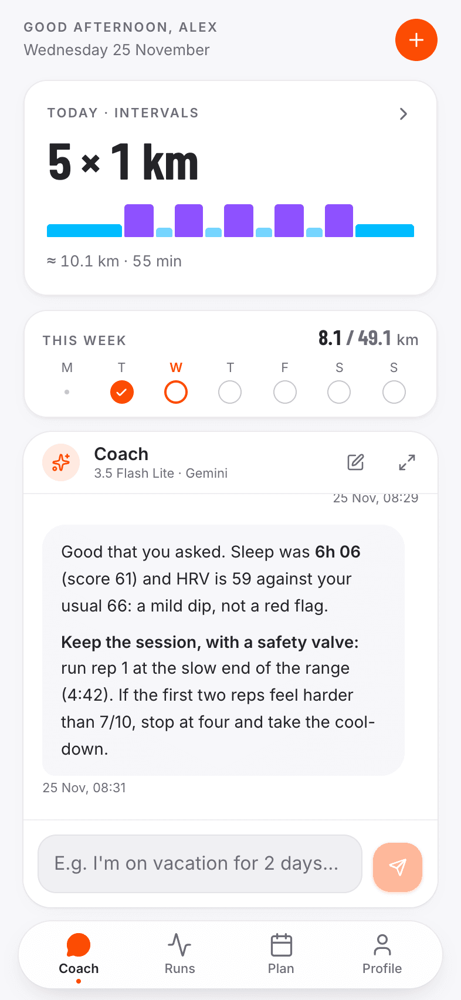
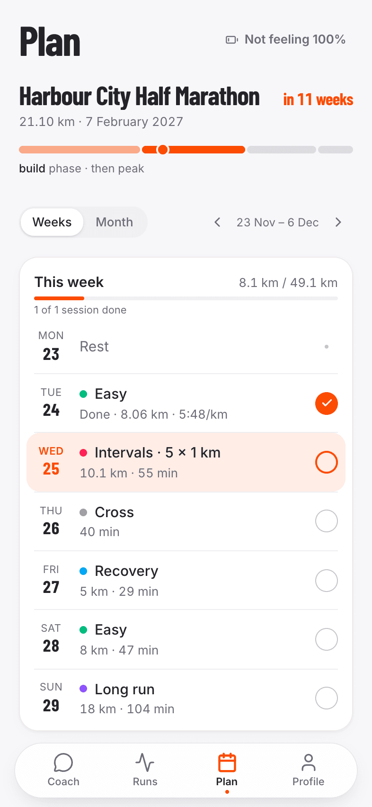
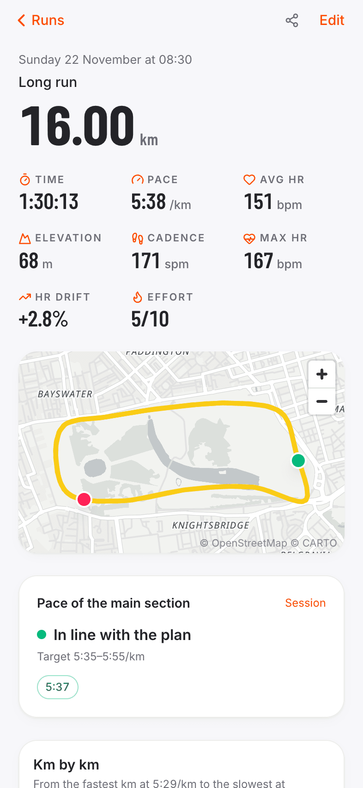
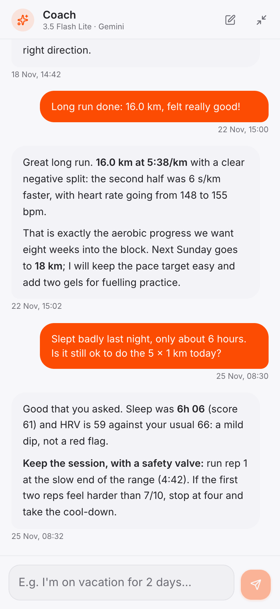
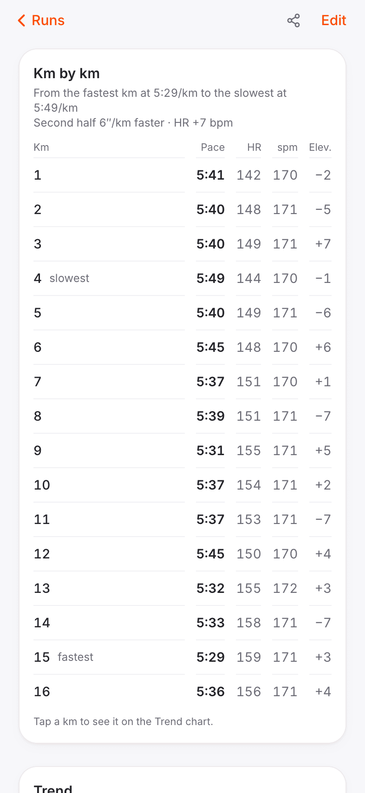
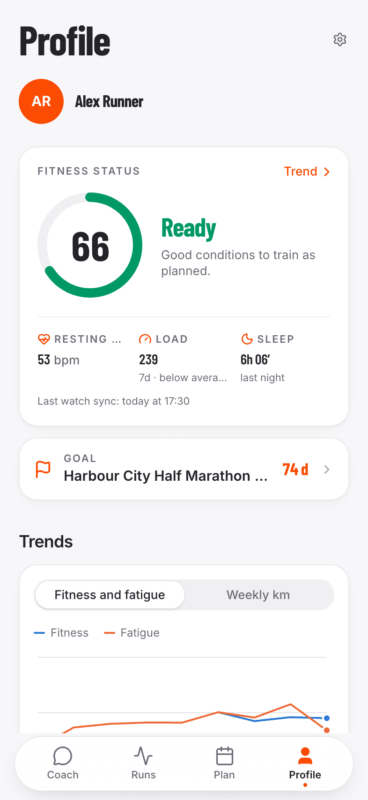
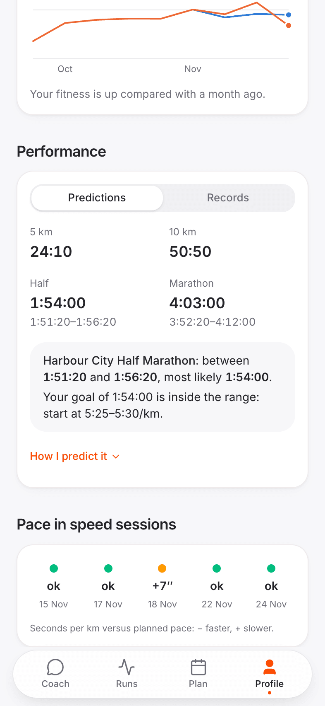
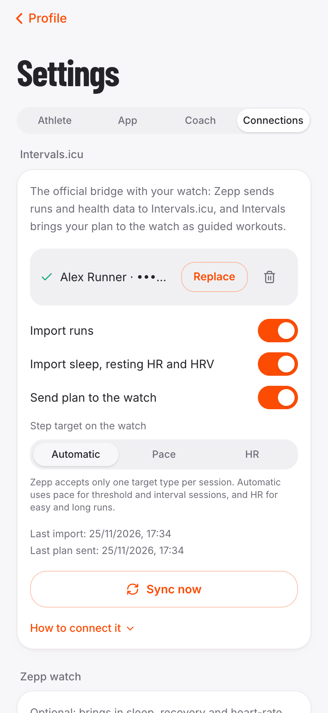

# Zitto e Corri

Zitto e Corri is a mobile-first running coach delivered as a Progressive Web
App. It combines activity tracking, training plans, performance insights, and a
personal AI coach (Gemini or OpenRouter) in one installable web app.

The app is available in English and Italian (see [Languages](#languages)).

<p align="center">
  
</p>

<p align="center">
  
  
  
  
</p>
<p align="center">
  
  
  
  
</p>

<sub>Screenshots use made-up demo data (`scripts/demo`).</sub>

## What it does

- Tracks running and other sports through manual entries or FIT/GPX imports.
- Shows routes, splits, heart-rate data, training load, and activity feedback.
- Manages race goals and a rolling 14-day training plan, with training phases,
  a race-day pacing plan and a recovery proposal after the race.
- Adapts the plan when you don't feel 100% (lighter, shorter or paused
  sessions, reversible in one tap) and slows target paces in hot, humid weather
  using the Open-Meteo forecast (no API key needed).
- Tracks progress: fitness and fatigue over time, weekly distance against the
  plan, race predictions, personal records, pace checks on quality sessions and
  running totals by week, month, year and all time.
- Provides a conversational coach that can suggest plan changes for approval.
  Each athlete brings their own key: Gemini (Google AI Studio) or OpenRouter
  (one key for hundreds of models), with a model per task (chat, run analysis).
- Works with or without a race: the goal can be a race with a date, a generic
  "get better at this distance", or no goal at all.
- Keeps each athlete's coach memory, preferences, and data separate.
- Supports automatic imports through a personal access key.
- Imports runs and nightly health data (sleep, resting HR, HRV) from Intervals.icu
  and publishes the plan there, so Amazfit watches receive the next 7 days as
  native structured workouts.
- Optionally uses health summaries from a compatible Zepp OS watch.
- Works as an installable PWA on mobile and desktop browsers.

## Requirements

- Node.js 20.9 or later
- npm
- A Supabase project
- Optionally, Google OAuth configured in Supabase Authentication (email sign-in needs no setup)
- An AI key for each user who wants AI coaching: Gemini (Google AI Studio) or
  OpenRouter

## Getting started

### Deploy to Vercel

[](https://vercel.com/new/clone?repository-url=https%3A%2F%2Fgithub.com%2FLorenzogallone%2FZittoAndCorri&env=NEXT_PUBLIC_SUPABASE_URL,NEXT_PUBLIC_SUPABASE_PUBLISHABLE_KEY,SUPABASE_SECRET_KEY,CRON_SECRET&envDescription=Supabase+project+URL+and+keys+%28Project+Settings+%E2%86%92+API%29,+plus+any+random+string+for+CRON_SECRET&envLink=https%3A%2F%2Fgithub.com%2FLorenzogallone%2FZittoAndCorri%23getting-started&project-name=zitto-e-corri&repository-name=zitto-e-corri)

The button copies the repository to your GitHub account and asks for the
Supabase URL and keys. You still need to create the Supabase project, apply
the migrations and set up sign-in, as described below. The cron jobs in
`vercel.json` start on their own.

### Run locally

Install the dependencies and create the local environment file:

```bash
npm install
cp .env.example .env.local
```

Set the following values in `.env.local`:

```dotenv
NEXT_PUBLIC_SUPABASE_URL=https://your-project.supabase.co
NEXT_PUBLIC_SUPABASE_PUBLISHABLE_KEY=your-publishable-key
SUPABASE_SECRET_KEY=your-server-side-secret-key
```

Initialize the Supabase database by applying every SQL file in
`supabase/migrations` in order (`0001` to `0033`; numbers 0020 and 0031 do not
exist). On an existing database apply only the files newer than the last one
you ran. Paste each file into the Supabase SQL editor (or run them with `psql`).

Sign-in uses Supabase Auth. Email magic links work out of the box; Google is
optional.

1. **Email (default, no setup).** In Supabase, **Authentication → URL
   Configuration**: set the Site URL to your app's URL and add
   `http://localhost:3000/auth/callback` and `https://<your-app>/auth/callback`
   to the redirect URLs. Supabase's built-in mailer then sends the sign-in
   link. It is limited to a few emails per hour and only to your team members'
   addresses, so for production set up your own SMTP server under
   **Authentication → Emails → SMTP Settings**.
2. **Google (optional).** In the [Google Cloud console](https://console.cloud.google.com/),
   configure the OAuth consent screen, then **APIs & Services → Credentials →
   Create credentials → OAuth client ID**, type **Web application**. Add
   `https://<your-project-ref>.supabase.co/auth/v1/callback` as an authorized
   redirect URI, copy the client ID and secret, and paste them in Supabase
   **Authentication → Sign In / Providers → Google**. The button is shown by
   default; set `NEXT_PUBLIC_AUTH_GOOGLE=false` to hide it if you skip this
   step.

Start the development server:

```bash
npm run dev
```

Optional variables (see `.env.example`): `NEXT_PUBLIC_VAPID_PUBLIC_KEY`,
`VAPID_PRIVATE_KEY` and `VAPID_SUBJECT` for push notifications, and
`CRON_SECRET` for the scheduled jobs. Without the VAPID keys the app works,
minus notifications; the cron endpoints reject calls without `CRON_SECRET`.

Open [http://localhost:3000](http://localhost:3000), sign in with your email (or
Google), and complete the onboarding flow. AI features remain disabled until the user adds a
personal Gemini or OpenRouter key, in onboarding or later under
**Settings → Coach**.

## Languages

The interface is available in Italian and English, with
[next-intl](https://next-intl.dev) and no language prefix in the URLs. The
language is stored in the `NEXT_LOCALE` cookie, chosen on the first onboarding
step or in **Settings → App**; without a cookie it follows the browser's
`Accept-Language` (Italian or English, else Italian).

The chosen language is also saved on the profile (`profiles.locale`, migration
`0033`), because cron jobs and push notifications have no cookie: the reminder
for tomorrow's session, the weekly recap (including the coach message, written
in that language), the "analysis ready" and stale-data alerts follow the saved
language. Without the migration they stay in Italian.

Messages live in `messages/<language>/<area>.json`, one file per area, so areas
can be translated independently. A new area must be added to `NAMESPACES` in
`i18n/config.ts`; `tests/i18n.test.ts` checks that every language has the same
keys and placeholders. `messages/GLOSSARY.md` lists the fixed running terms.
All screens, date and number formats (`intlLocale()`: `it-IT` or `en-GB`) and
the labels built in `lib/` follow the chosen language. The AI coach answers in
that language through one language rule added to each prompt
(`languageRule()` in `lib/ai/prompt.ts`); the instructions themselves stay in
Italian. Still Italian: text already stored in the database (past coach
messages, notes, memories), push notifications sent by cron jobs, and the text
written into workouts published to the watch.

## First-run onboarding

New users go through five short steps (`app/onboarding`), all skippable except
where noted. Everything can be changed later in Settings.

1. **Welcome** — what the app does: coach, plan, runs and progress, watch.
2. **About you** — maximum and resting heart rate, birth date (used for zones).
3. **Goal** — prepare a race (distance and date required, name and target time
   optional), improve on a distance (no date, generic goal) or just train (no
   goal).
4. **Coach AI** — choose Gemini or OpenRouter and paste the key; the key is
   verified before saving. For OpenRouter pick a suggested model (the first
   chat and analysis model) or type a model id; without a model the key is not
   enough to start the coach. OpenRouter needs
   `supabase/migrations/0023_coach_proposals_and_openrouter.sql`.
5. **Watch** — which watches are supported (Amazfit today, other brands in
   progress) and an option to open **Settings → Connections** right after.

## Main areas

- **Coach** — next workout with its intensity profile, this week at a glance,
  and the AI chat.
- **Activities** — running totals, manual entries, FIT/GPX uploads, pace-coloured
  maps, pace checks, records, shareable images and AI feedback.
- **Plan** — week-by-week plan with what was done or missed, a month view,
  training phases, moving sessions and "Not feeling 100%".
- **Profile** — goal, training status, fitness and fatigue, weekly distance,
  race predictions, personal records and pace trend.
- **Settings** — athlete data, heat adjustment, appearance, notifications,
  AI keys and models (Gemini, OpenRouter), imports, Intervals.icu and Zepp OS.

## Supported watches

| Watch | Status | How |
| --- | --- | --- |
| Amazfit Balance 2, Active 3 Premium | Available | [Intervals.icu](#intervalsicu-integration-recommended-for-amazfit-watches) for runs, health data and plan on the watch; optional [Zepp OS app](#zepp-os-integration-optional) for recovery metrics and the "Today" widget |
| Garmin and other brands | In progress | Not integrated yet. FIT and GPX files from any watch can be imported meanwhile |

## Activity imports

FIT and GPX files can be reviewed and imported directly from the Activities
screen. External services can use the personal import key generated in
**Settings → Imports** as a bearer token:

| Endpoint | Input |
| --- | --- |
| `POST /api/import` | One activity or an array of activities as JSON |
| `POST /api/import/gpx` | Raw GPX content |
| `POST /api/import/file` | A FIT or GPX file |

Send the key with `Authorization: Bearer <personal-import-key>`. Regenerating
the key immediately invalidates the previous one.

## Intervals.icu integration (recommended for Amazfit watches)

Zepp has an official link with Intervals.icu (Amazfit Balance 2, T-Rex 3 Pro
and newer). Zepp uploads completed workouts and wellness data to Intervals.icu
and downloads planned workouts from it to the watch. Zitto e Corri uses the
Intervals.icu public API with the athlete's personal key:

- runs are imported as FIT files (GPS, heart rate, laps), deduplicated by
  Intervals.icu activity id and analysed like any other import;
- sleep, resting heart rate, HRV, SpO2 and steps go to `wellness_daily` and feed
  the readiness score (HRV against the personal median);
- the future plan (up to a year) is published as `WORKOUT` events (one target
  per step: pace on work steps, heart rate elsewhere, or as chosen in
  settings), updated after every plan change and removed when a session
  disappears; Zepp loads the next 7 days onto the watch.

Setup, step by step:

1. Apply `supabase/migrations/0025_intervals_icu.sql` (included if you applied
   every migration).
2. Create a free account on [Intervals.icu](https://intervals.icu).
3. In the Zepp phone app: **Profile → Third-party accounts → Intervals.icu**
   and sign in. From now on Zepp uploads your runs and wellness data there.
4. On Intervals.icu: **Settings → Amazfit** box, turn on downloading of
   wellness data and HRV.
5. Still in Intervals.icu Settings, at the bottom (**Developer settings**),
   copy your API key.
6. In Zitto e Corri: **Settings → Connections → Intervals.icu**, paste the key
   and save. Syncing then runs on its own (see the schedule below).

After a run, open the Zepp app: it reaches Intervals.icu within seconds and
Zitto e Corri within an hour (or immediately when you open the app). The next 7
days of the plan appear on the watch in the Workout app.

The sync runs from `/api/cron/intervals` in the morning and again inside
`/api/cron/daily` in the afternoon, so it happens twice a day even on the
Vercel Hobby plan. Data leaves the watch only when the Zepp phone app syncs it.

## Zepp OS integration (optional)

**Intervals.icu alone covers most of the data**: runs, sleep, resting heart
rate, HRV, SpO2, steps and the plan on the watch. You only need the Zepp OS
app if you also want the numbers Zepp does not pass on to Intervals.icu:
training load, recovery time, VO₂max and heart-rate zones, plus a "Today"
widget with the planned session on the Balance 2. It does not replace FIT/GPX
imports and does not create workouts.

To connect: enable Zepp OS in **Settings → Connections**, generate the six-digit
pairing code (valid for 5 minutes, single use) and enter it in the app's
settings in the Zepp phone app. Building and installing the app needs a Zepp
developer account and Developer Mode on the phone: see the
[Zepp OS app README](zepp-app/README.md).

## What the coach can change

The chat coach proposes plan changes for confirmation (new or changed sessions
in the next 4 weeks, and sessions to remove, including a session from the last
14 days that was not run: "I skipped it" or "I'll do it today"). It can also act
on recorded runs right away, reversibly: exclude a run from totals, records and
training load (illness, aborted session, duplicate file), restore it, or record
the perceived effort. Excluded runs stay visible with their reason and can be
restored from the run page. Requires `supabase/migrations/0026_coach_full_control.sql`.

The coach also keeps **training guidelines** (memory category `guideline`): the
rules agreed for the current goal or block, such as weekly volume, long-run
progression, the key session, strength and race week. They override the
generic methodology in plans, evaluations and chat, expire with `valid_until`,
and are written, updated or closed from the chat, by the athlete or whoever
manages the app. Requires `supabase/migrations/0027_coach_guidelines.sql`.

A day can hold **more than one session** (e.g. easy in the morning and
strength in the evening). A coach proposal for a day replaces all the sessions
planned that day; on a day already run, from today on, it can only add sessions
and never touches the existing ones. Each session is its own Intervals.icu
event. Requires `supabase/migrations/0028_same_day_workouts.sql`.

Sessions on the same day carry their order, the part of the day (morning,
afternoon, evening) and whether they are **chained**: done straight after the
previous one, as a single outing split in two for the watch (e.g. warm-up, then
intervals). The coach plans and reviews chained sessions as one workout and
separate ones as two stimuli, run evaluations see the other activities of the
same day, and Intervals.icu events are timed so they stay in order. Requires
`supabase/migrations/0029_linked_sessions.sql`.

## Notifications

Push notifications are optional: workout reminder for tomorrow, "analysis
ready" after each activity, and a Monday recap from the coach. Apply
`supabase/migrations/0019_push_notifications.sql`, then generate a VAPID key
pair and set the variables listed in `.env.example`:

```bash
npx web-push generate-vapid-keys
```

Users enable notifications per device in **Settings → Notifications** (on iPhone,
the app must be added to the Home Screen first). The section is hidden when
`NEXT_PUBLIC_VAPID_PUBLIC_KEY` is not set.

The scheduled jobs are plain endpoints protected by `CRON_SECRET`:

| Endpoint | Schedule (UTC) | Purpose |
| --- | --- | --- |
| `GET /api/cron/intervals` | `0 5 * * *` | Intervals.icu import and plan publishing |
| `GET /api/cron/daily` | `30 16 * * *` | Reminder for tomorrow's planned workout and second Intervals.icu sync |
| `GET /api/cron/weekly` | `0 6 * * 1` | Recap of the previous week, saved in the coach chat |

On Vercel they run automatically from `vercel.json` (Vercel sends
`CRON_SECRET` as the bearer token). Any other scheduler can call them with
`Authorization: Bearer <CRON_SECRET>`.

## PWA installation

Deploy the app over HTTPS, open it in a supported browser, and choose **Install
app** or **Add to Home Screen**. The installed PWA uses the same account and data
as the browser version.

## Security and data

- Supabase Row Level Security separates user data.
- The Supabase secret key is used only by server-side code.
- Gemini and OpenRouter keys are supplied by users and stored encrypted
  through Supabase Vault.
- Zepp OS uses a dedicated revocable token created during pairing.
- Import keys and pairing codes should be treated as private credentials.

## Commands

| Command | Purpose |
| --- | --- |
| `npm run dev` | Start the local development server |
| `npm run build` | Create a production build |
| `npm run start` | Run the production build |
| `npm run test:core` | Run the core test suite |
| `npm run typecheck` | Check TypeScript types |
| `npm run lint` | Run ESLint |

Before deploying, run:

```bash
npm run test:core
npm run typecheck
npm run lint
npm run build
```

The production environment uses the same three Supabase variables shown above.
Make sure the public application URL is configured in Supabase Authentication
and that the deployment supports HTTPS.

## Disclaimer

Zitto e Corri is a personal project, not a medical device. Training plans,
AI feedback and race predictions are estimates: listen to your body and talk
to a doctor before starting or changing training, especially with health
conditions. The AI coach runs on your own Gemini or OpenRouter key, and their
terms and costs apply. Amazfit, Zepp, Garmin, Intervals.icu and the other names
mentioned are trademarks of their owners; this project is not affiliated with
or endorsed by them.

## License

[MIT](LICENSE): use it, change it and make it your own.
